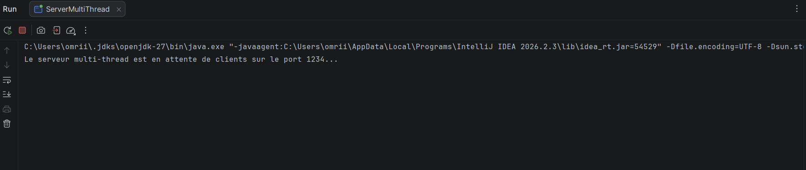
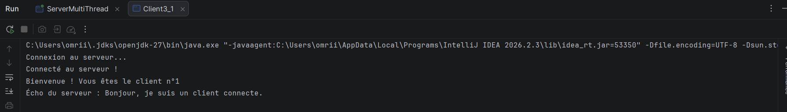
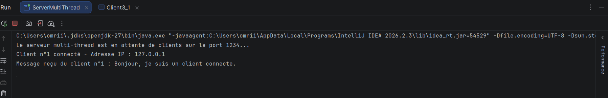
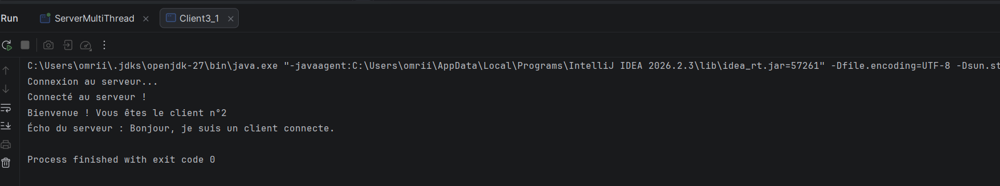
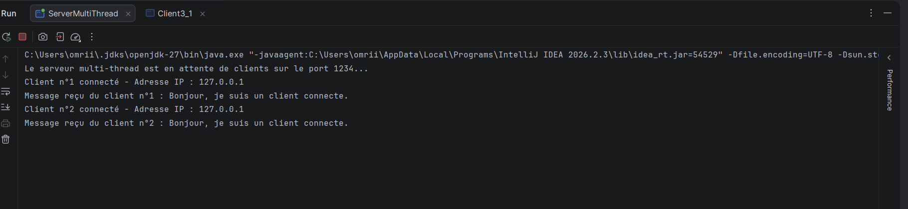
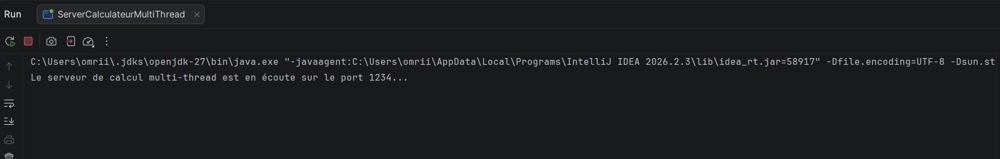
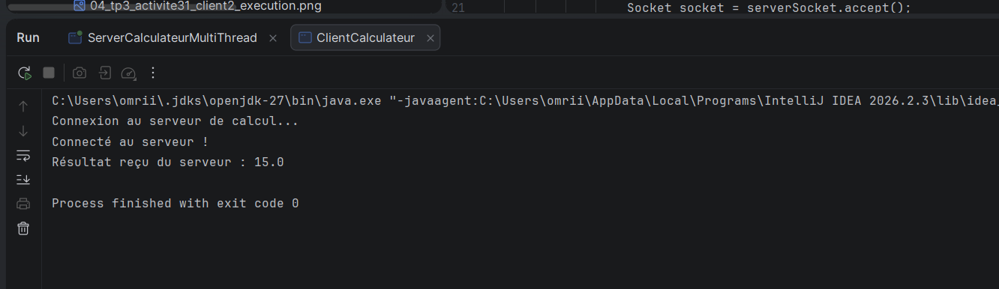
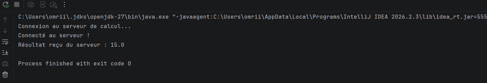
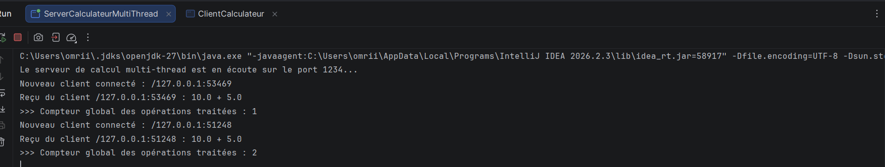

# TP3 – Serveur Multi-threads : Sockets en mode connecté TCP

Ce projet est réalisé dans le cadre du TP3 de la matière **Développement d’applications réparties**, durant l’année universitaire 2026–2027, à la Faculté des Sciences de Sfax.

## 📌 Activité 3-1 : Acceptation de plusieurs clients (Serveur Multi-thread)

### 1. Présentation et Objectifs

Les applications Client/Serveur développées dans les TP précédents ne permettaient de gérer qu'un seul client à chaque exécution du serveur. L'objectif de cette activité est de concevoir un **serveur multi-thread** capable de traiter plusieurs clients simultanément en utilisant les sockets TCP.

Les objectifs principaux sont :
- Comprendre et appliquer le principe d'un serveur multithread basé sur les sockets TCP en Java.
- Gérer l'affichage des informations de chaque client connecté (adresse IP via `getRemoteSocketAddress()` et numéro d'ordre).
- Envoyer à chaque client son numéro d'ordre de communication.

### 2. Architecture et Principe de fonctionnement
- **Le Serveur Principal (`ServerMultiThread`) :** Écoute en permanence sur le port `1234` via une boucle infinie (`while(true)`). Dès qu'un client se connecte (`accept()`), il incrémente un compteur et lance un thread indépendant.
- **Le Gestionnaire de Client (`ClientHandler`) :** Implémente l'interface `Runnable` pour dialoguer avec chaque client en parallèle, récupérer son adresse IP et lui attribuer son numéro d'ordre de connexion.
- **Le Client (`Client3_1`) :** Se connecte au serveur, lit son message d'accueil personnalisé (numéro d'ordre) et échange des données.

### 3. Captures d'écran et Résultats (Activité 3-1)

- **3.1. Démarrage du serveur :**
  Mise en écoute du serveur multi-thread sur le port 1234.
  

- **3.2. Exécution du Client n°1 :**
  Connexion réussie du premier client et réception de son numéro d'ordre.
  

- **3.3. Détection du Client n°1 côté serveur :**
  Affichage des informations du client connecté (adresse IP et numéro d'ordre).
  

- **3.4. Exécution du Client n°2 :**
  Connexion simultanée du deuxième client gérée en parallèle par le serveur.
  

- **3.5. Gestion simultanée des clients côté serveur :**
  Affichage consolidé montrant le traitement multi-threads des deux clients connectés.
  

---

## 📌 Activité 3-2 : Amélioration de l'application calculatrice (Serveur multi-thread & Compteur partagé)

### 1. Présentation et Objectifs

Cette activité consiste à reprendre le service de calculatrice développé dans les TP précédents et à l'intégrer dans un serveur multi-thread utilisant une communication par objets (`ObjectOutputStream` et `ObjectInputStream`). L'objectif est également d'introduire un **compteur global partagé** gérant les accès concurrents entre les différents threads clients grâce au mot-clé `synchronized`.

### 2. Architecture et Principe de fonctionnement
- **Objets partagés (`modelPackage`) :** Les classes `Operation` et `Resultat` implémentent `Serializable` pour permettre l'échange de requêtes de calcul entre le client et le serveur.
- **Serveur de Calcul Multi-thread (`ServerCalculateurMultiThread`) :** Contient le compteur global partagé (`nombreOperations`) et une méthode synchronisée `incrementerCompteur()` pour sécuriser l'accès concurrent.
- **Thread de Traitement (`ClientCalculProcess`) :** Exécute le calcul demandé par chaque client de manière isolée et incrémente le compteur en toute sécurité.
- **Client Calculateur (`ClientCalculateur`) :** Se connecte au serveur, envoie une opération sous forme d'objet et affiche le résultat retourné.

### 3. Captures d'écran et Résultats (Activité 3-2)

- **3.1. Démarrage du serveur de calcul :**
  Mise en écoute du serveur multi-thread de calcul sur le port 1234.
  

- **3.2. Exécution du Client n°1 :**
  Envoi d'une opération par le premier client et réception du résultat calculé.
  

- **3.3. Exécution du Client n°2 en parallèle :**
  Connexion et traitement simultané d'un second client par le serveur.
  

- **3.4. Gestion des accès concurrents (Compteur global) :**
  Affichage côté serveur montrant l'incrémentation sécurisée et cohérente du compteur partagé suite aux requêtes simultanées.
  

---

## 🚀 Conclusion
Cette extension du TP3 m'a permis de maîtriser la transmission d'objets via les sockets réseau et de comprendre la gestion de la concurrence en Java à l'aide des threads et du mécanisme de synchronisation (`synchronized`). Le projet est désormais capable de traiter des flux multiples de manière fiable et sécurisée.